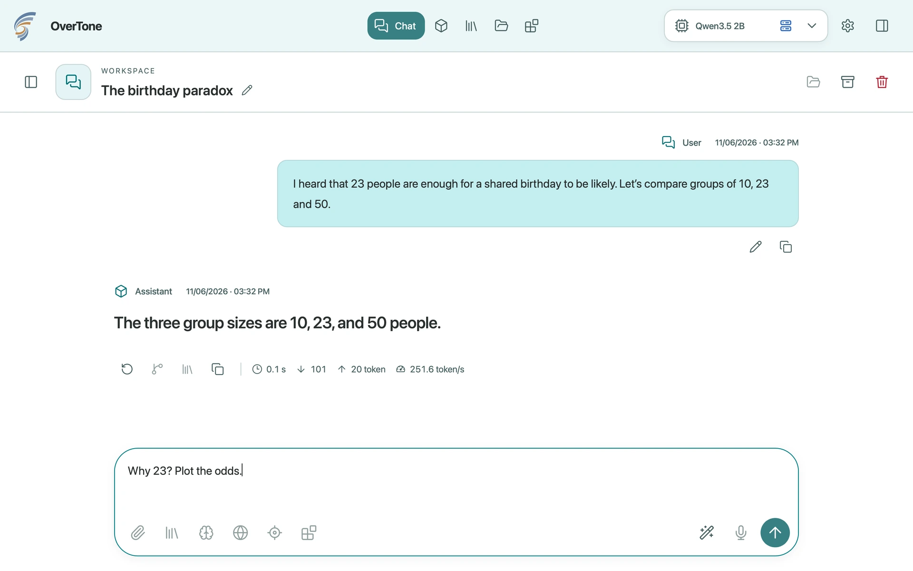

# OverTone

A local-first desktop workspace for conversations with language models. Choose your own local
engine and models, or explicitly connect a server using a supported protocol.

**Runs on Apple silicon with macOS 14 or later.** Windows and Linux are future targets.
This is a development build. It is signed locally, not notarized for distribution.

A compiled development preview is available for Mac. It is not notarized by Apple; macOS requires
an explicit first-open approval. Source builds remain available for development.

[Explore OverTone](https://overcesare.github.io/OverTone/) · [Walkthroughs](https://overcesare.github.io/OverTone/#in-action) · [Community](CONTRIBUTING.md)



## Download and install

[Download for Mac — Apple silicon](https://github.com/OverCesare/OverTone/raw/refs/heads/main/site/assets/downloads/OverTone-0.1.0-macos-arm64-preview.dmg) · [Installation guide](https://overcesare.github.io/OverTone/getting-started.html)

1. Open the DMG and drag **OverTone** into **Applications**.
2. Open OverTone from Applications.
3. If macOS cannot verify the developer, use **System Settings → Privacy & Security → Open Anyway**.
   Confirm only if you obtained the app from this repository or the project's website.
   Follow [Apple's instructions](https://support.apple.com/en-us/102445); managed Macs may restrict this exception.
4. Follow the initial setup to choose a local engine and model, reuse an existing installation,
   or connect a compatible server. Internet access starts off.

No compiler, package manager or Terminal command is required for the downloaded app.
The DMG is about 2.7 MB; engines and models are separate, larger downloads.
To update, quit OverTone before replacing the app. Its data is stored separately.
This is an early development preview, not a stable release.

## Build from source

Install Apple's Command Line Tools (`xcode-select --install`) with the macOS 15 SDK or newer
(Xcode 16 or newer), then:

```sh
make -j"$(sysctl -n hw.logicalcpu)"
make run
```

`make` builds the executable in `build/overtone`. `make run` installs and opens the single
application `/Applications/OverTone.app`; `make install` updates it without opening it. Close
OverTone before updating. Build and sanitizer outputs are ordinary executables, not additional
applications registered with macOS. Use `INSTALL_DIR="$HOME/Applications"` if a per-user
installation is needed, choosing one installation location consistently.

`make package` installs the same app and creates `build/OverTone-local.zip` with a SHA-256
checksum. It makes no network submission or publication. The installed bundle is signed locally
and its resources are verified before the old installation is replaced. The ZIP contains only
OverTone, its UI and license notices; profiles, engines and models remain outside it.

The build is offline and needs no package manager. C17 implements the application logic;
Objective-C connects it to macOS. WebKit renders local HTML, CSS and plain JavaScript without a
frontend build step. SQLite and the system frameworks ship with macOS; yyjson is included here.

On first launch, choose an existing model, install an engine and model, or skip setup and configure
later. Downloads require your permission. Open a chat with **⌘N**, search the current view with
**⌘F**, and use **⌘1–5** to switch sections. The active model's name opens its parameters.

## What works

- **Setup and engines:** reuse an existing installation, connect a compatible server, or download
  private Ollama/llama.cpp components and a model. Engines only and skipping setup are supported.
  Back or quitting pauses unfinished work; confirming the same plan resumes it. Completed
  components are kept. Neither engine is required by the app itself.
- **Chat:** streaming, Stop, reasoning controls when supported, edits and answer alternatives,
  drafts, search/filters, archive/trash, automatic titles and context summaries. You can browse
  other conversations while a reply generates. Archived/trashed chats are read-only until restored.
  Prompt improvement can develop an incomplete request, fix wording and structure, or leave a clear
  message unchanged. It uses a bounded, read-only portion of the selected conversation. Review, edit,
  accept or discard the proposal; quality depends on the model. The draft stays intact until accepted
  or sent, and the rewriting request never becomes a chat message.
- **Models:** search Hugging Face or Ollama, import GGUF files, discover local models and filter
  the library. Downloads have progress, pause/resume/cancel and a persistent queue. Direct HTTPS
  links require SHA-256; a replacement keeps the old file until the new one passes verification.
  External files are not silently deleted.
- **Parameters and memory:** select a model in the top bar; click its name for settings saved
  separately per model. The engine starts automatically. Recommended parameters adapt to the model
  and available memory; estimates improve with compatible local observations and remain approximate.
- **Suggestions:** model variants are compared against the computer's resources and your intended
  use. Local personalization keeps bounded statistics, not prompt copies; it sends no learning data.
  Disable or reset it in Settings. Setup offers a shortlist; later advice proposes a qualified upgrade
  only when one is found. A separate verification badge identifies content actually tested with OverTone.
- **Servers:** Ollama and OpenAI-compatible APIs work locally or remotely. Verify an address and
  choose one of its advertised models. HTTPS is the remote default; HTTP is limited by macOS to IP
  addresses, unqualified hosts and `.local` names. API keys may be saved in the Mac's Keychain or
  kept for the session. Provider-specific integrations and account sign-in are not implemented.
- **Preferences:** System/light/dark appearance, six tones, ten languages, local regional formats,
  assistant style, startup model, memory residency, data folder, backup/restore and NDJSON export.
  An optional guide explains the app's main controls.

**Internet access starts off.** Settings → Privacy provides a master switch and separate permissions
for catalogues, model downloads, engine downloads and remote servers. Online catalogue caches also
require consent; existing local models work offline. Generated images and links never cause an
automatic remote fetch. Model and engine licenses remain separate from OverTone's license.

Global sections sit above the workspace, contextual navigation on the left and optional Details
on the right. **Documents, Projects and Tools have prepared interfaces; their document, research,
plugin and automation workflows are not implemented yet.** Disabled controls identify prepared
capabilities. See the [product contract](docs/product-contract.md) for the current boundary.

Answers use one reading style with distinct user messages, bounded Markdown, tables and optional
bar/flow figures. Default instructions request concise, direct, technical answers without emojis;
they are editable and do not guarantee a model's accuracy. No model-authored HTML or scripts run
in the interface.

The default profile is `~/Library/Application Support/OverTone`. A different profile can be
selected explicitly, including one on another disk:

```sh
/Applications/OverTone.app/Contents/MacOS/overtone --profile /absolute/path/to/profile
```

The optional `--setup` flag reopens the initial setup without deleting models, conversations or settings.

The default installation does not scan Desktop or Documents. Selecting a custom data folder,
model or backup there may require macOS permission. The app does not change system privacy settings.

Profiles must be private to the current user and cannot be opened by two instances. Before the
first release, use a fresh test profile when the schema changes. There are no migrations for old
experimental formats. Backups preserve the current database, including settings and library
references; model weights themselves are not copied. Restore applies at the next launch and
retains the previous database as `previous.sqlite`.

## Community

See the [community and contribution guide](CONTRIBUTING.md) for bug reports, questions,
experience feedback, ideas, and pull requests. Report vulnerabilities according to the
[security policy](SECURITY.md).

## Development

```sh
make -j"$(sysctl -n hw.logicalcpu)" check
make -j"$(sysctl -n hw.logicalcpu)" SANITIZE=1 check fuzz
```

`check` exercises real temporary databases, files and supervised processes. `fuzz` applies
10,000 deterministic mutations to streams, settings and engine observations, plus 1,000 GGUF mutations. Tests do not need a model, network service,
private workflow or reference screenshots. See [development](docs/development.md) for native
checks, measurement and extension boundaries.

Inspect the running instance without opening the UI:

```sh
/Applications/OverTone.app/Contents/MacOS/overtone --inspect "$HOME/Library/Application Support/OverTone"
```

This reads a bounded, local snapshot of operations, resources, storage status and owned engine
state. It does not expose prompts, answers, keys, model names or filesystem paths. See
[diagnostics](docs/diagnostics.md) for the snapshot and opt-in developer commands that restore the
test window, resize it and exercise named UI controls without browser automation permissions.

The approved logo and animation keep their own fixed palette, independently of interface accents.
The editable macOS icon is in `src/macos/OverTone.icon`; the supplied `Assets.car` and `OverTone.icns`
are installed together, with the ICNS fallback for macOS 14. Recompile the catalog with Apple's
Icon Composer/`actool` only after changing the icon source; ordinary builds use the checked-in assets.

## Source layout

| Path | Responsibility |
| --- | --- |
| `src/` | Chat, storage, preferences, models, acquisition, inventory and resource policy |
| `src/macos/` | Native shell, network transport, hardware, process supervision and local inspection |
| `ui/` | Presentation, Markdown subset and translations; no filesystem or network access |
| `tests/` | Focused behavioural checks and stream mutation runner |
| `third_party/yyjson/` | Bundled parser, license and upstream source hashes |
| `docs/` | Architecture, development, diagnostics and product contract |

[Architecture](docs/architecture.md) documents ownership, bounds and tradeoffs. OverTone uses Apache-2.0; [third-party notices](THIRD_PARTY_NOTICES.md) cover the code
actually included.
